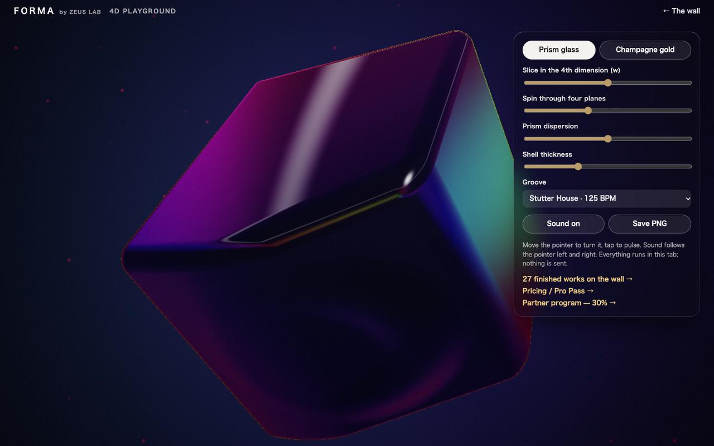

# forma-4d-core

[](https://forma-zero.com/playground/?utm_source=github)

**Live preview:** [forma-zero.com/playground](https://forma-zero.com/playground/?utm_source=github) — turn it with the pointer, change the slice, the spin and the dispersion, add one of eleven grooves, save a PNG.
**Built with it:** [FORMA](https://forma-zero.com/?utm_source=github) — 27 finished works on one living wall; Pro Pass starts with a 7-day free trial. Creators can [list their own work](https://forma-zero.com/submit/?utm_source=github) and keep 80% of FORMA-sent sales for their first 90 days (70% after).

A four-dimensional form, sliced live in the browser. One WebGL2 fragment shader, one small JavaScript file, no dependencies, no build step.

A tesseract shell is blended with a Clifford torus in four dimensions, rotated through the xw, yz, zw and xy planes, and sliced at a moving `w`. The camera sees that 3D slice. Two materials: champagne-gold metal on obsidian, and glass with per-channel refraction (prism dispersion). The pointer turns the camera through a damped spring; a tap sends one pulse.

**Live:** this core runs the first view of [forma-zero.com](https://forma-zero.com/?utm_source=github) and the [4D Playground](https://forma-zero.com/playground/?utm_source=github) (eleven grooves, save a PNG).

## Use

```html
<canvas id="cv" style="position:fixed;inset:0;width:100%;height:100%"></canvas>
<script src="src/forma-4d-core.js"></script>
<script>
  const stage = H4D.make(document.getElementById("cv"), { mat: 1 }); // 1 = prism glass, 0 = gold
  stage.set("slice", 0.2);   // position in the 4th dimension
  stage.set("spin", 0.45);   // rotation speed through four planes
  stage.set("disp", 0.045);  // prism dispersion (glass)
  stage.set("thick", 0.032); // shell thickness
  stage.pulse();             // one pulse, as on a tap
</script>
```

Open `index.html` for a demo with sliders (serve the folder with any static server, for example `python3 -m http.server`).

### Options for `H4D.make(canvas, options)`

| Option | Default | What it does |
|---|---|---|
| `mat` | `0` | `0` gold metal, `1` prism glass |
| `spin`, `disp`, `thick` | `.45`, `.045`, `.032` | starting values (also settable with `set`) |
| `scale`, `cap` | `.7`, `1.25` | render scale and the device-pixel-ratio cap (performance) |
| `host` | the canvas | element whose pointer moves turn the camera |
| `keep` | `false` | keep the drawing buffer (needed for `canvas.toBlob`) |
| `offset` | `[0,0]` | shift the form `[[wide x, y], [tall x, y]]` so text can sit beside it |
| `zoom` | `1` | `[wide, tall]` camera distance factor |
| `onFrame` | — | callback `(x, y, dt)` with the spring-smoothed pointer, for parallax UI |

`stage.state.level = () => [low, high, kick]` lets an audio analyser drive the slice and the light.

### Behaviour

- Pauses when the tab is hidden or the canvas is off-screen (IntersectionObserver).
- With `prefers-reduced-motion`, it draws one frame and redraws only on input.
- Returns `null` when WebGL2 is unavailable (the canvas gets the class `nogl`), so you can show a still image instead.
- It reads and sends nothing.

## More from ZEUS LAB

- **FORMA** — 27 finished works on one living wall (web, film, 3D, decks, type and sound). Type your brand once and every work wears it. [Free to try](https://forma-zero.com/?utm_source=github) · [Pro Pass: 7 days free, then $19/month or $149/year](https://forma-zero.com/pricing/?utm_source=github)
- **ZEUS LAB** — free browser tools (Paste-Guard seals client names and keys before you paste into AI; a risk calculator with 5,000 simulated paths) and the kits behind them. [zeuslab-zero.com](https://zeuslab-zero.com/products/?utm_source=github)
- Partner program: 30% of each FORMA sale you refer — [formazero.gumroad.com/affiliates](https://formazero.gumroad.com/affiliates)

## License

MIT — see [LICENSE](LICENSE). The paid FORMA works and kits are sold separately under their own licence and are not part of this repository.
